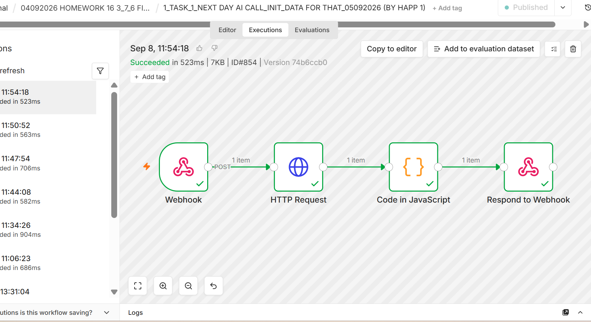
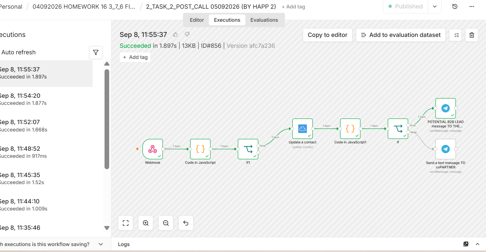
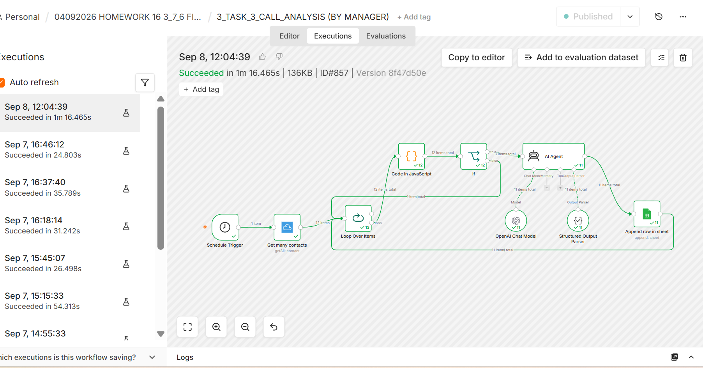
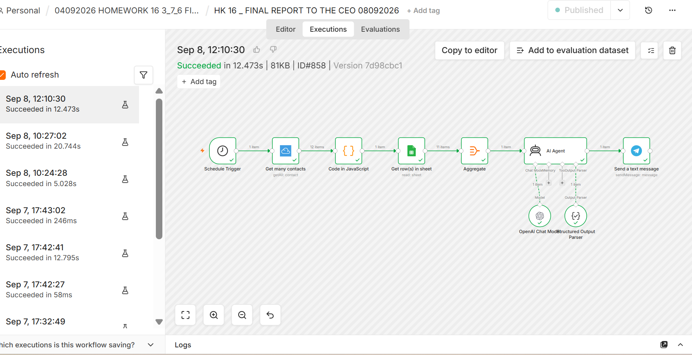
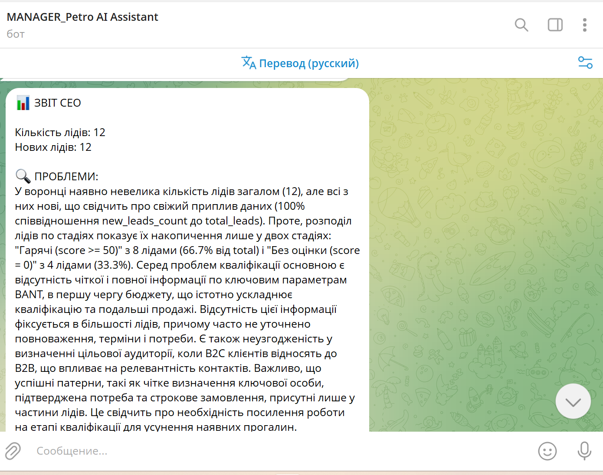

# AI Voice Lead Qualification for a B2B Solar Distributor

**n8n · Happ.tools Voice Agent · Agile CRM · OpenAI · Google Sheets · Telegram**

Every lead called, scored and reported to the CEO - automatically.

> Training project (GoIT AI Automator) based on a realistic B2B solar distribution scenario.

## Problem

A B2B wholesale distributor of solar systems received leads from a website form (name, phone, email).

- A sales manager had to call every lead by hand to qualify it (BANT: Budget, Authority, Need, Timeline)
- Questions and notes were inconsistent from call to call
- CRM was updated manually
- The CEO had no standardized view of pipeline quality

## Solution

An AI voice agent ("Dmytro") plus connected n8n workflows:

| # | Workflow | What it does |
|---|---|---|
| 0 | `0-create-test-leads.json` | Creates test leads in Agile CRM (demo data) |
| 1 | `1-init-data-lead-lookup.json` | Webhook from the voice agent → finds the lead in Agile CRM by phone → returns name and company to personalize the greeting |
| 2 | `2-post-call-crm-update.json` | Receives the call summary and BANT score (0-100) → updates Agile CRM → Telegram alert: hot lead (score ≥ 50) or not qualified |
| 3 | `3-call-analysis.json` | Daily: AI agent reviews every call summary - agent mistakes, client problem, what worked → Google Sheets |
| 4 | `4-ceo-report.json` | Weekly: CRM data + call analysis → AI diagnosis (problems, bottleneck, recommendations) → one report to the CEO in Telegram |

**Voice agent rules:** frames every call as a follow-up to the website inquiry, asks BANT questions one at a time, scores internally without voicing the score, and always saves the summary **before** saying goodbye (voice models tend to skip tool calls placed after the goodbye phrase).

## Results (test batch)

- 5 connected components: 1 voice agent + 4 n8n workflows
- 12 test leads processed end-to-end
- 100% of completed calls produced a structured BANT summary instead of free-form notes
- ~58% of qualified leads flagged as hot (score ≥ 50) - a clear priority list for sales
- 1 consolidated CEO report generated automatically from 11+ call analyses

## Screenshots

**1 - Lead lookup (INIT_DATA)**

**2 - Post-call processing**

**3 - AI call analysis**

**4 - CEO report workflow**

**Example of the CEO report in Telegram**

## How to use

1. In n8n: **Workflows → Import from file** → import each JSON
2. Connect your own credentials: Agile CRM, HTTP Basic Auth (Agile CRM API), OpenAI, Google Sheets, Telegram
3. Replace placeholders:
   - `YOUR_DOMAIN.agilecrm.com` - your Agile CRM domain
   - `YOUR_GOOGLE_SHEET_ID` - sheet for call analysis results
   - `YOUR_TELEGRAM_CHAT_ID` - manager / CEO chat
4. In your voice platform, point the `init` and `save_call_summary` tools to the webhook URLs of workflows 1 and 2
5. Activate the workflows

No API keys or personal data are included in this repository.

## Author

**Petro Volkov** - AI Automation for Logistics & Sales
[Upwork](https://www.upwork.com/freelancers/~01bf694cbbacdc6c7d) · [Portfolio](https://app.notion.com/p/Petro-Volkov-AI-Automator-39aa3189d4e1803ab7ece06f01930819) · [LinkedIn](https://linkedin.com/in/petro-volkov-5a576b87)
